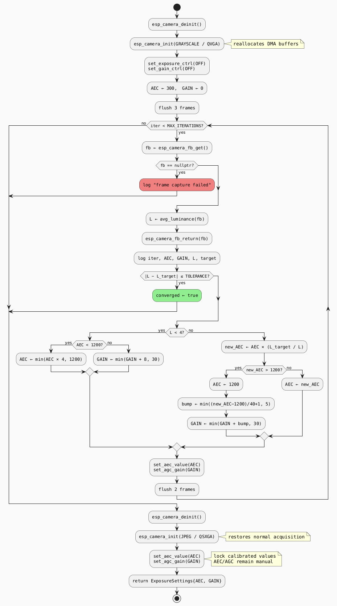
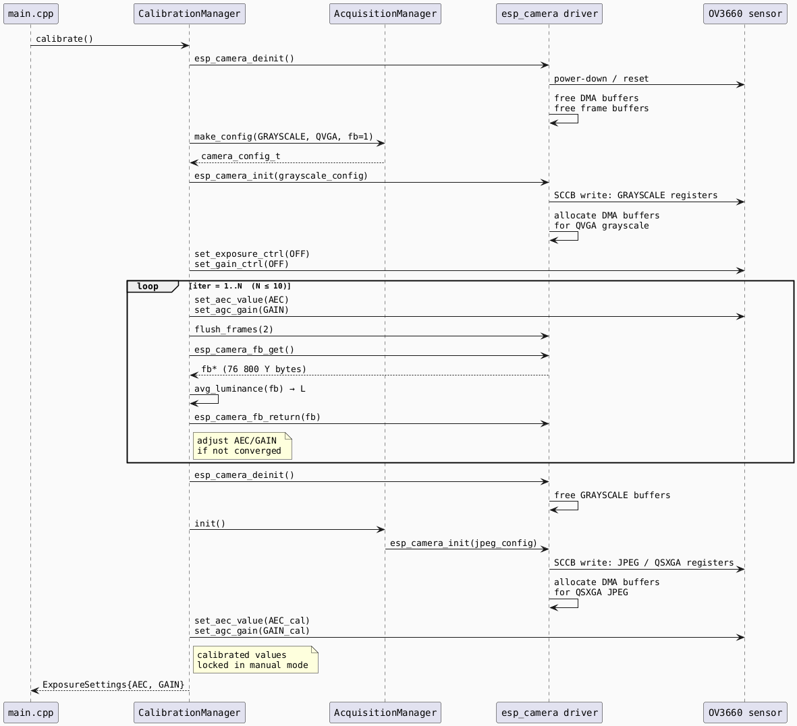
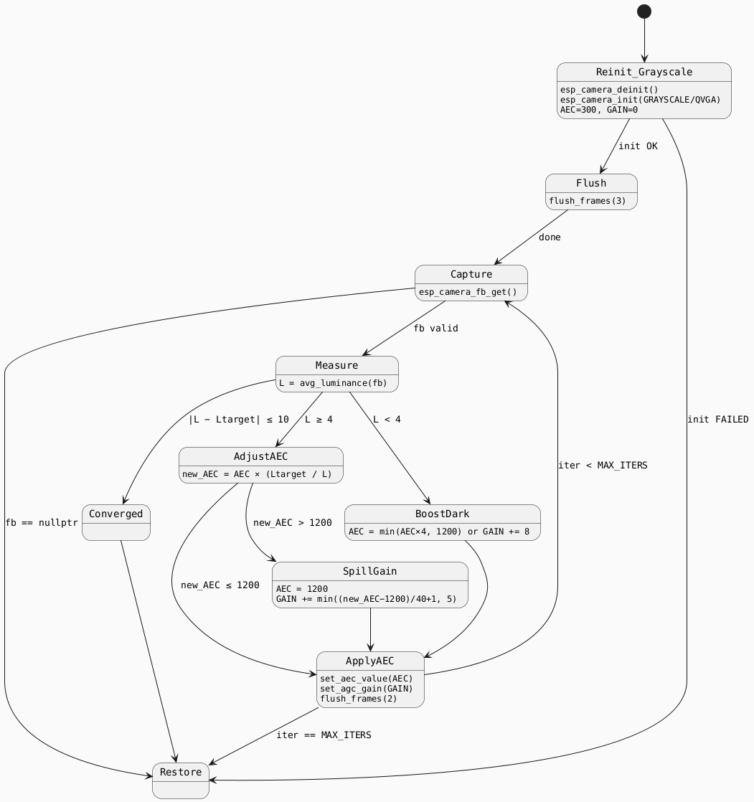

# Camera Exposure Calibration

## Overview

The calibration routine finds the correct **AEC value** (exposure time) and
**AGC gain** so that the average luminance of a captured frame matches a
pre-defined target grey.  It runs once at boot and then every 30 minutes to
track changing light conditions.

---

## 1. The Problem

A camera sensor maps scene radiance to pixel values.  For a given scene we
want to choose an exposure `E` and gain `G` such that the mean pixel value
sits at a target luminance `L_target`:

```
mean(frame) ≈ L_target
```

On the OV3660 the two independent controls are:

| Symbol | Register | Range | Unit |
|--------|----------|-------|------|
| `E`    | `aec_value` | 0 – 1200 | line-periods |
| `G`    | `agc_gain`  | 0 – 30   | index into gain table |

---

## 2. Luminance Metric

Calibration captures in `PIXFORMAT_GRAYSCALE` at `FRAMESIZE_QVGA`
(320 × 240 = 76 800 pixels).  Each pixel byte is a direct **Y (luma)**
sample, so the metric is simply:

$$
\bar{L} = \frac{1}{N} \sum_{i=0}^{N-1} p_i
\qquad N = 320 \times 240 = 76\,800
$$

Integer arithmetic is safe because:

$$
\sum p_i \;\leq\; 255 \times 76\,800 = 19\,584\,000 \;<\; 2^{32}
$$

---

## 3. Proportional Correction (P-Controller)

### 3.1 Linear sensor model

Assume the sensor response is linear in both `E` and `G`:

$$
\bar{L} = k \cdot E \cdot g(G)
$$

where `g(G)` is the gain look-up factor and `k` is a scene-dependent
constant that absorbs reflectance, aperture, etc.

### 3.2 One-step update rule

Given a measurement `L_n` at exposure `E_n`, the ideal correction is:

$$
\boxed{E_{n+1} = E_n \cdot \frac{L_{\text{target}}}{L_n}}
$$

Substituting back into the linear model:

$$
L_{n+1}
= k \cdot E_{n+1} \cdot g(G)
= k \cdot \left(E_n \cdot \frac{L_{\text{target}}}{L_n}\right) \cdot g(G)
= L_n \cdot \frac{L_{\text{target}}}{L_n}
= L_{\text{target}}
$$

**A perfectly linear sensor converges in a single iteration.**

### 3.3 Non-linear / saturated case

Real sensors saturate at 255.  If the sensor clips, the measured `L_n` is
an underestimate of the true scene brightness.  The controller still drives
`E` in the right direction but overshoots less than a bang-bang controller
would.  Define the per-step error:

$$
e_n = \bar{L}_n - L_{\text{target}}
$$

For a saturated first frame (`L_0 = 255`):

$$
E_1 = E_0 \cdot \frac{100}{255} \approx 0.39\, E_0
$$

The reduction is large enough to pull the sensor out of saturation in the
next frame.  Convergence is **monotonically decreasing in error** as long as
`L(E)` is strictly increasing.

### 3.4 Worked example — bright scene

| Iter | `E` | `L` measured | Action |
|------|----:|-------------:|--------|
| 1 | 300 | 240 | `E = 300 × 100/240 = 125` |
| 2 | 125 | 115 | `E = 125 × 100/115 = 108` |
| 3 | 108 | 102 | `|102 − 100| = 2 ≤ 10` → **converged** |

### 3.5 Worked example — very dark scene

| Iter | `E` | `G` | `L` | Action |
|------|----:|----:|----:|--------|
| 1 | 300 | 0 | 2 | `L < 4` → `E = min(1200, 1200)` |
| 2 | 1200 | 0 | 8 | `new_E = 15 000 > 1200` → `E=1200`, `G += 5` |
| 3 | 1200 | 5 | 20 | `new_E = 6 000 > 1200` → `G += 5` |
| 4 | 1200 | 10 | 42 | `new_E = 2 857 > 1200` → `G += 5` |
| 5 | 1200 | 15 | 88 | `new_E = 1 364 > 1200` → `G += 2` |
| 6 | 1200 | 17 | 101 | `|101 − 100| = 1 ≤ 10` → **converged** |

---

## 4. Gain Cascade

When the proportional step would require `E > 1200` the excess correction
spills into gain:

```
new_E  = E_n × (L_target / L_n)

if new_E > 1200:
    E      = 1200
    bump   = min( (new_E − 1200) / 40 + 1 , 5 )   // at most +5 per iter
    G      = min( G + bump , 30 )
else:
    E      = new_E
```

The `/ 40` damping prevents gain from jumping to its ceiling in one step,
which would overshoot on the next iteration.

### 4.1 Maximum achievable brightness

At `E = 1200`, `G = 30` the sensor is at its absolute maximum.  If even
this cannot reach `L_target`, calibration ends after `MAX_ITERATIONS` and
the best-effort values are used.

---

## 5. Termination

```
converged  ←  |L_n − L_target| ≤ TOLERANCE   (TOLERANCE = 10)
max_iters  ←  MAX_ITERATIONS = 10
```

Either condition ends the sweep.

---

## 6. Why deinit / reinit Instead of set_pixformat

`set_pixformat()` writes OV3660 sensor registers but does **not** reconfigure
the ESP32 DMA engine.  The DMA buffers are sized and mapped during
`esp_camera_init()` for the chosen pixel format.  Switching format at runtime
leaves the DMA expecting the old stream layout, and every subsequent
`esp_camera_fb_get()` returns `nullptr`.

The only reliable method is a full driver cycle:

```
esp_camera_deinit()          // release DMA, I2S, frame buffers
esp_camera_init(GRAYSCALE)   // reallocate everything for new format
... calibrate ...
esp_camera_deinit()
esp_camera_init(JPEG)        // restore normal acquisition config
```

---

## 7. PlantUML Diagrams

### 7.1 Calibration Algorithm



---

### 7.2 Deinit / Reinit Sequence



---

### 7.3 Controller State Machine



---

## 8. Constants Reference

| Constant | Value | Rationale |
|----------|------:|-----------|
| `TARGET_GRAY` | 100 | Below neutral grey (128) to avoid blowing out point light sources (street lamps, windows) in night scenes |
| `TOLERANCE` | 10 | ±10 / 255 ≈ ±4 % — tight enough for consistent exposure |
| `MAX_ITERATIONS` | 10 | Bounds worst-case calibration time to ≈ 4 s (10 × (2 flush × 80 ms + capture)) |
| `AEC` start | 300 | Mid-range biased toward low-light; converges quickly in both directions |
| `AEC` max | 1200 | OV3660 hardware limit (full-frame integration) |
| `GAIN` max | 30 | OV3660 AGC register ceiling |
| Frame format | GRAYSCALE / QVGA | Direct Y bytes; no JPEG decode needed; 76 800 bytes fits PSRAM comfortably |
| Flush after setting change | 2 frames | DMA pipeline depth; ensures the new exposure is fully applied |
| Flush after init | 3 frames | Sensor settling time after SCCB register write burst |
